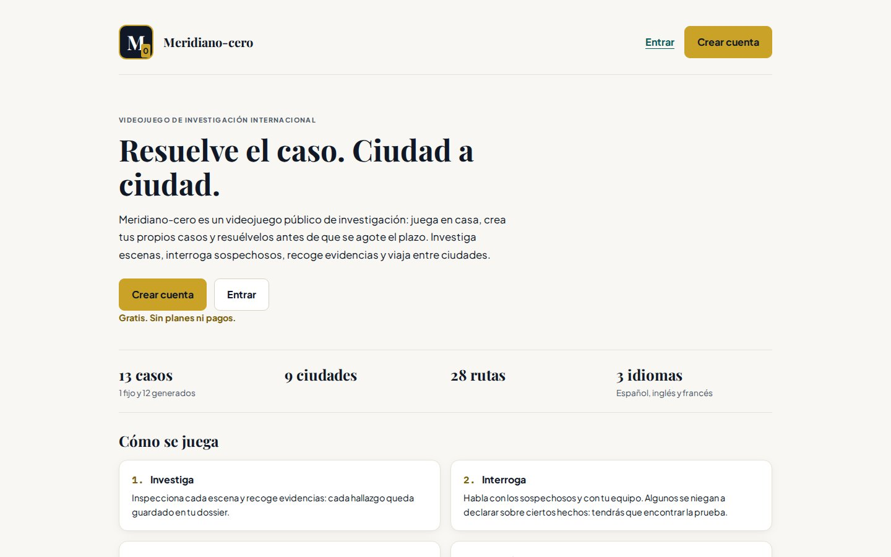
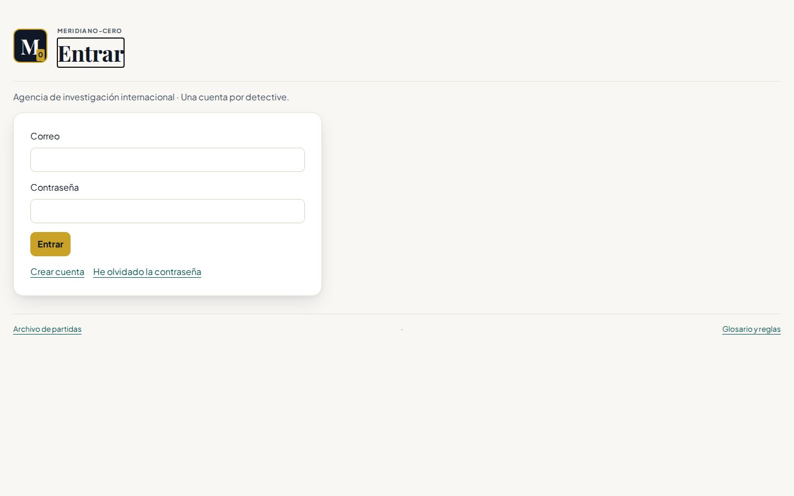
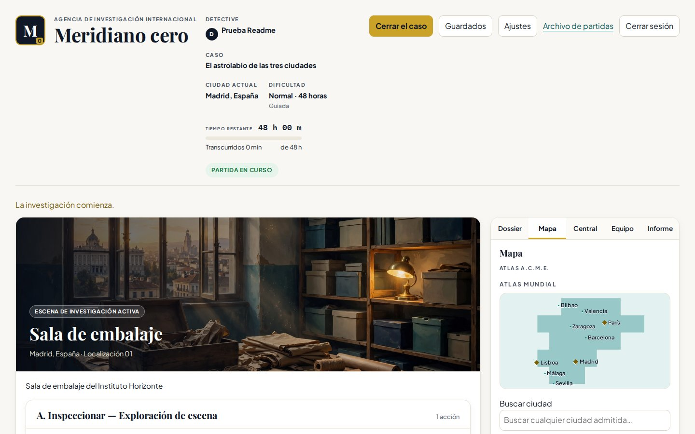
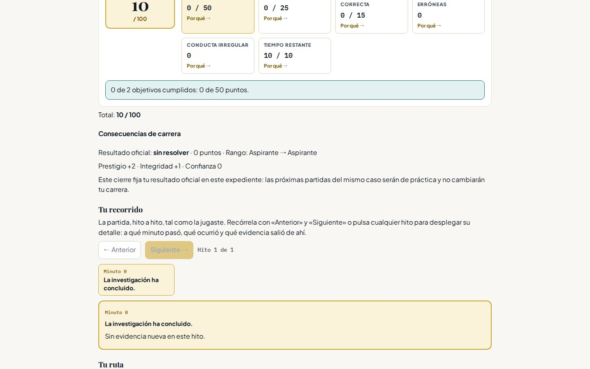

# Meridiano-cero

> **Resuelve el caso. Ciudad a ciudad.**

[](LICENSE)
[](https://meridianocero.laurafernandezenfermeria.com/)

**Meridiano-cero** es un videojuego público de investigación internacional: juega en casa, crea tus propios casos y resuélvelos antes de que se agote el plazo. Investiga escenas, interroga sospechosos, recoge evidencias y viaja entre ciudades. Eres detective de la agencia internacional **A.C.M.E.** y el caso es tuyo.



| 13 casos | 9 ciudades | 28 rutas | 3 idiomas |
| :---: | :---: | :---: | :---: |
| 1 fijo y 12 generados | Madrid, Barcelona, Valencia, Sevilla, Bilbao, Málaga, Zaragoza, París y Lisboa | con tiempos de viaje reales | Español, inglés y francés |

## Cómo se juega

### 1. Elige un caso… o crea el tuyo

Regístrate, abre tu archivo de partidas y elige un expediente del catálogo. Cada caso tiene su propio plazo: en el caso fijo, **Fácil 96 horas, Normal 48 horas y Difícil 24 horas**. También eliges el modo de exploración: **guiada**, con las ciudades del expediente conocidas desde el principio, o **libre**, en la que las ciudades se descubren investigando.



### 2. Investiga la escena

Cada caso empieza en un lugar: inspecciona, recoge evidencias y habla con quien estaba allí. Cada hallazgo queda guardado en tu dossier, y cada acción consume minutos de tu plazo. El reloj es interno del caso: cuando se agota, la investigación se cierra.


### 3. Interroga y analiza

Habla con los sospechosos y con tu equipo. Algunos se niegan a declarar sobre ciertos hechos: tendrás que encontrar la prueba que los haga hablar. Las evidencias se analizan en el **Dossier**, donde también sigues tus objetivos, tus solicitudes en curso y tus órdenes.


### 4. Viaja por el mapa

El atlas de A.C.M.E. muestra tus destinos y las rutas entre ellos. Viajar cuesta tiempo, así que cada desplazamiento es una decisión: ¿vas a París tras esa pista o te quedas en Madrid a atar cabos?



### 5. Cierra el caso y recorre tu informe

Cuando tengas la orden válida y conozcas la ubicación del sospechoso, pide su detención. Al cerrar el caso, el **informe final interactivo** te muestra tu recorrido hito a hito: qué ocurrió, a qué minuto y qué evidencia salió de ahí, con tu puntuación y sus consecuencias para tu carrera.



## El caso fijo: «El astrolabio de las tres ciudades»

Un astrolabio de la exposición del Instituto Horizonte, en Madrid, ha desaparecido durante su traslado. La pieza estaba en la sala de embalaje y ya no está. Empiezas en esa sala, donde se preparó el envío: habla con quien estaba allí, inspecciona la sala y sigue el rastro. El caso puede llevarte a París y a Lisboa si las pruebas te llevan hasta allí.

Tus objetivos: **detener a Inés con una orden válida** y **recuperar el astrolabio original**.

## 13 casos y un generador que no improvisa

La versión alojada incluye **13 casos**: el caso fijo más **12 casos generados**. El generador crea expedientes nuevos a partir de 12 delitos —robo, desaparición, fraude, espionaje, sabotaje, misterio histórico, extorsión, contrabando, corrupción, falsificación, homicidio y secuestro— con sus lugares, personajes, pruebas y rutas alternativas.

Nada de lo que juegas es improvisado:

- Cada caso generado pasa por **validación**: solo los expedientes validados entran en el catálogo. Los borradores que no cumplen las reglas se rechazan con su motivo.
- El **motor es determinista**: las rutas, los tiempos y las reglas son las mismas en cada partida. La IA narra y conversa, pero no inventa pruebas ni cambia las reglas.
- Los casos se pueden **exportar e importar** entre instalaciones, así que un expediente creado en tu equipo se puede jugar en otro.

### Crea tus propios casos

Desde el archivo de partidas puedes generar un caso nuevo: elige el delito, la dificultad, la duración, la región y el contenido (Familiar o General), o pulsa **SORPRÉNDEME** y deja que el juego sortee por ti. La generación usa el proveedor predeterminado del servidor, así que cualquier jugador registrado puede generar sin tener su propia clave de IA.

## Tu IA, en tu equipo

Meridiano-cero está pensado para que juegues con **tu propia inteligencia artificial, en tu casa**:

- **Ollama o LM Studio, en local.** Conecta tu modelo local y juega sin que tus partidas salgan de tu equipo.
- **También valen proveedores en la nube** —Anthropic, Google, OpenAI y cualquier servicio compatible con OpenAI— si prefieres usarlos.
- **La configuración es por jugador, no global.** Tu conexión manda sobre la predeterminada del servidor; y si tu conexión falla, el juego te lo dice: nunca cambia de modelo en silencio a tus espaldas.
- **Sin IA también se juega.** El modo simulado permite jugar y probar casos sin ningún modelo.

## Una sola pantalla, todo a mano

El juego se juega en una única pantalla, sin ventanas que se pierdan:

- **Dossier**: tus evidencias, objetivos, solicitudes y órdenes.
- **Mapa**: el atlas y tus viajes.
- **Central**: tus comunicaciones.
- **Equipo**: tu equipo de A.C.M.E. —Margaret Sullivan, directora; el Dr. Samuel Richter, laboratorio; Elena Vázquez, inteligencia; David Nakamura, viajes y detenciones; y Clara Beaumont, expedientes—. Pedir consejo a Elena o una valoración a Margaret es gratis y sus respuestas solo usan lo que ya consta en tu expediente: nunca te dicen quién es el culpable.
- **Informe**: el estado de tu caso y el cierre.
- **Consola narrativa** abajo, con la historia tal como la vas viviendo, y **chat con los personajes** dentro de la propia escena.

Y si te gusta arriesgar, puedes jugar sucio: forzar un acceso, sobornar o suplantar. Cuesta tiempo, te pueden ver —y si te ven tres veces, A.C.M.E. te retira el caso— y lo que consigas así no es admisible como prueba.

## Tu carrera de detective

Cada caso cerrado deja huella: puntos, medallas y rango —**Aspirante, Detective, Sargento e Inspector**— y una reputación que sube con los casos limpios y baja con las detenciones erróneas y la conducta irregular. El primer resultado oficial de cada expediente es el que cuenta para tu carrera; repetir un caso es práctica, para probar otras decisiones. Con el **autoguardado** y hasta **10 guardados manuales por partida**, puedes volver atrás y jugarlo de otra forma.

El juego se puede jugar **entero con el teclado**, con lector de pantalla, y trae alto contraste, paletas para daltonismo, reducción de movimiento, lectura en voz alta y tamaño de texto ajustable. También tiene música retro sintetizada en tu navegador y efectos discretos, que puedes silenciar desde Ajustes.

## Juega ahora

La versión alojada está en **[meridianocero.laurafernandezenfermeria.com](https://meridianocero.laurafernandezenfermeria.com/)**, con registro público. Crea tu cuenta y empieza a investigar.

¿Prefieres tenerlo en tu máquina? Instálalo en local:

```text
git clone https://github.com/elkangri23/Meridiano-cero.git
cd Meridiano-cero
pnpm install --frozen-lockfile
pnpm setup:local
docker compose -f compose.yaml up -d --wait
pnpm db:migrate
pnpm dev
```

Requisitos: **Node.js 24.22.1, pnpm 12.15.0 y Docker** (o un PostgreSQL 16 local). La web de desarrollo abre en <http://127.0.0.1:5173> y la API en <http://127.0.0.1:3000/api/v1/health>. La instalación completa, el autoalojamiento con Docker y las variables están en [docs/manuales/INSTALACION.md](docs/manuales/INSTALACION.md).

> Una instalación limpia trae solo el caso fijo: los casos generados no viajan con el repositorio; se crean con el generador o se importan desde otra instalación.

## Idiomas

El juego está **completo en español, inglés y francés**, y puedes cambiar de idioma dentro de la partida. El español es el idioma principal del proyecto y de esta documentación.

Las versiones de este README en otros idiomas están en camino:

- `README.fr.md` (français) — *próximamente*
- `README.en.md` (English) — *coming soon*

La ayuda y la documentación en francés e inglés también llegarán después.

## Para desarrolladores

Meridiano-cero es **software libre bajo licencia AGPL-3.0** (ver [LICENSE](LICENSE), [NOTICE.md](NOTICE.md) y [AUTHORS.md](AUTHORS.md)). Está escrito en TypeScript, con un motor determinista, un generador de casos, una API y una web.

- [Índice de la documentación](docs/README.md) — requisitos, funcionalidades, arquitectura y manuales.
- [Cómo se juega (manual completo)](docs/COMO-JUGAR.md) — reglas, acciones, detenciones, carrera y accesibilidad.
- [Instalación y autoalojamiento](docs/manuales/INSTALACION.md) — desarrollo local, despliegue y copias de seguridad.
- [Contribuir](CONTRIBUTING.md).

Comprobaciones habituales:

```text
pnpm build
pnpm typecheck
pnpm test
pnpm eval:ai --mock
python3 scripts/verify_docs.py
```

> **Nota:** *Meridiano-cero* es el nombre del proyecto y *A.C.M.E.* el nombre provisional de la agencia. Ambos están pendientes de confirmación antes de publicar.

---

*Capturas tomadas el 2026-11-18 de la versión alojada, en español. El juego es Meridiano-cero; la agencia es A.C.M.E.*
