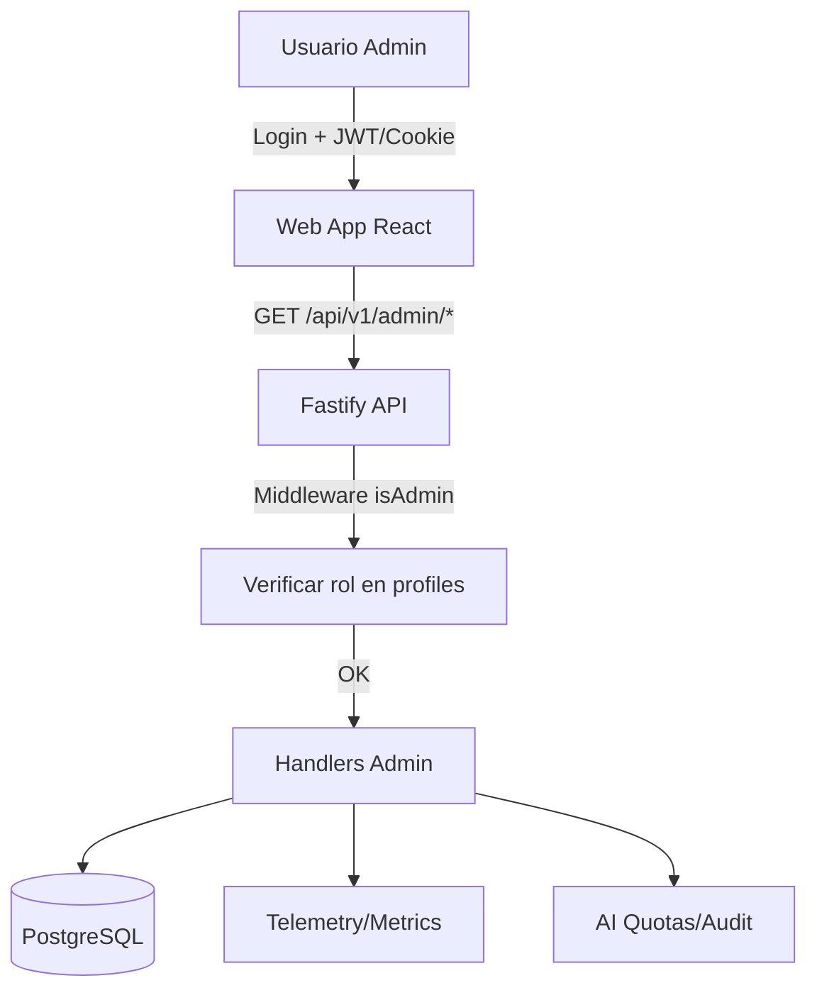

# Panel de Administración y Auditoría (Admin Dashboard)

* **Autor:** Antonio Moles
* **Fecha:** 2026-11-12
* **Estado:** Borrador (Draft)

## 1. El Problema (The Problem)

Actualmente, Meridiano-cero carece de una interfaz de gestión y telemetría centralizada para el desarrollador y administrador de la plataforma. La supervisión del sistema (estado de la base de datos, uso de modelos de IA, generación de casos, salud de sesiones y errores en producción) requiere acceso directo a contenedores Docker o consultas SQL manuales. Además, no existe un mecanismo accesible mediante interfaz web para realizar tareas operativas críticas, como revocar sesiones, gestionar usuarios, restablecer cuotas de IA o auditar fallos del sistema.

## 2. Visión General (Overview)

El Panel de Administración (Admin Dashboard) proporcionará un centro de control operativo y de auditoría integrado en la aplicación web, restringido a usuarios con el rol `admin`. Ofrecerá métricas en tiempo real sobre el uso de recursos e IA, listado e inspección de usuarios y partidas, visibilidad de los trabajos de generación de casos, registro de auditoría de seguridad y herramientas de intervención de emergencia.

## 3. Objetivos (Goals)

* **Visibilidad Operativa Real:** Mostrar métricas claras de salud del sistema (uso de IA, respuestas/errores, tiempo de latencia, cuotas, trabajos de generación de casos activos/fallidos y partidas en curso). **Metricas clave:** latencia media < 2s, tasa de error < 5%, uso de tokens por proveedor/modelo.
* **Gestión de Usuarios y Sesiones:** Permitir al administrador listar usuarios, cambiar roles, revocar sesiones activas y desactivar cuentas de forma inmediata.
* **Control de IA y Cuotas:** Permitir supervisar el consumo de tokens por proveedor/modelo y ajustar o reiniciar cuotas de IA sin reiniciar servicios. **Metricas clave:** tokens consumidos vs límite, tiempo de latencia medio, errores por modelo.
* **Auditoría de Seguridad y Eventos:** Registrar y consultar eventos relevantes (intentos de autenticación, errores de API, fallos de IA y cambios administrativos). **Metricas clave:** número de eventos por tipo, tendencia temporal.
* **Seguridad y Control de Acceso:** Garantizar que todas las rutas del panel y los endpoints administrativos asociados estén estrictamente protegidos mediante verificación de rol `admin` en el backend.

## 4. No Objetivos (Non-Goals)

* No se pretende construir una herramienta generalista de visualización de métricas (como Grafana o Prometheus), sino un panel específico para el modelo de dominio de Meridiano-cero. **Referencia:** Véase ADR-001 y ADR-003.
* No se incluirán herramientas de edición directa del código fuente de los casos ni edición arbitraria de tablas SQL sin validación de dominio.
* No se habilitará acceso a usuarios con rol `player` o sin autenticación bajo ninguna circunstancia.

## 5. Plan Técnico (Technical Plan)

### 5.1 Arquitectura General

El panel de administración se integrará como una nueva sección dentro de la aplicación web existente (React + Vite + TypeScript), bajo la ruta `/admin/*`. El acceso estará protegido en frontend (guard de ruta) y backend (middleware de verificación de rol `admin`).

**Diagrama de flujo de datos (Mermaid):**

### 5.2 Componentes Principales

| Componente | Descripción | Ubicación |
|------------|-------------|-----------|
| **AdminGuard** | Protege rutas `/admin/*` verificando rol `admin` | `apps/web/src/routes/AdminGuard.tsx` |
| **AdminLayout** | Layout principal con sidebar y navegación | `apps/web/src/admin/AdminLayout.tsx` |
| **DashboardPage** | Vista principal con métricas de salud | `apps/web/src/admin/DashboardPage.tsx` |
| **UsersPage** | CRUD usuarios, roles, sesiones | `apps/web/src/admin/users/UsersPage.tsx` |
| **RunsPage** | Listado/filtrado de partidas, acciones | `apps/web/src/admin/runs/RunsPage.tsx` |
| **AIPage** | Métricas IA, cuotas, ajustes | `apps/web/src/admin/ai/AIPage.tsx` |
| **AuditPage** | Log de eventos, seguridad, auditoría | `apps/web/src/admin/audit/AuditPage.tsx` |
| **AdminAPI Routes** | Endpoints `/api/v1/admin/*` | `apps/api/src/admin/routes.ts` |
| **Admin Middleware** | `requireAdmin` verifica rol `admin` | `apps/api/src/admin/middleware.ts` |

### 5.3 Endpoints API (Backend)

| Método | Ruta | Descripción | Permisos |
|--------|------|-------------|----------|
| GET | `/api/v1/admin/health` | Salud general del sistema | admin |
| GET | `/api/v1/admin/metrics` | Métricas agregadas (IA, runs, usuarios) | admin |
| GET | `/api/v1/admin/users` | Listado paginado de usuarios | admin |
| PATCH | `/api/v1/admin/users/:id` | Actualizar rol, estado, emailVerified | admin |
| DELETE | `/api/v1/admin/users/:id/sessions` | Revocar todas las sesiones | admin |
| GET | `/api/v1/admin/runs` | Listado/filtro de partidas | admin |
| PATCH | `/api/v1/admin/runs/:id` | Cerrar/forzar cierre de partida | admin |
| GET | `/api/v1/admin/ai/metrics` | Uso tokens, latencia, errores por proveedor | admin |
| GET | `/api/v1/admin/ai/quotas` | Listado cuotas activas | admin |
| PATCH | `/api/v1/admin/ai/quotas/:id` | Ajustar límites/cuotas | admin |
| GET | `/api/v1/admin/audit` | Log paginado de eventos (filtro tipo/fecha) | admin |

### 5.4 Middleware de Autorización (`requireAdmin`)

Se añadirá un hook `onRequest` en Fastify que:
1. Extraiga el token de sesión de la cookie/header.
2. Consulte `profiles` y verifique `role === 'admin'`.
3. Responda `403 FORBIDDEN` si no es admin o sesión inválida.

### 5.5 Métricas y Telemetría

Se expondrán consultas SQL optimizadas (vistas materializadas o CTEs) para:
- **Uso IA:** Tokens totales, por proveedor/modelo, latencia media, tasa de error (últimas 24h/7d).
- **Partidas:** Activas, creadas/cerradas hoy, tiempo medio.
- **Usuarios:** Registrados hoy/semana, activos (sesión < 24h).
- **IA Cuotas:** Uso actual vs límite por scope.

### 5.6 Auditoría y Logs

Se añadirá tabla `admin_audit_log` (o reutilizar `operation_records` con `kind='admin_action'`) para registrar:
- Cambios de rol/estado de usuario.
- Revocación de sesiones.
- Ajustes de cuotas IA.
- Acciones sobre partidas (cierre forzado).
- Cada entrada: `admin_id`, `action`, `target_type`, `target_id`, `before/after (jsonb)`, `created_at`.

## 6. Alternativas Consideradas (Alternatives Considered)

| Alternativa | Descripción | Por qué se rechazó |
|-------------|-------------|---------------------|
| **Grafana + Prometheus externo** | Stack de observabilidad completo externo | *Rechazado por autor: sobrecarga operativa innecesaria; Meridiano-cero es una app monolítica ligera; el panel nativo cubre necesidades específicas del dominio (casos, runs, IA) que Grafana no modela de forma nativa.* |
| **Panel admin como app separada (subdominio)** | Desplegar admin como SPA independiente | *Rechazado por autor: complejidad de despliegue, autenticación compartida y CORS; compartir layout y componentes con la app principal reduce duplicación.* |
| **Edición SQL directa (Adminer/phpMyAdmin)** | Acceso directo a DB vía herramienta genérica | *Rechazado por autor: riesgo de corrupción de datos, sin validación de dominio, sin auditoría de cambios; no escala para operaciones de dominio (cerrar run, revocar sesión).* |
| **Usar rol `superuser` de PostgreSQL** | Permisos a nivel de BD | *Rechazado por autor: demasiado granular; la lógica de negocio (cerrar run, revocar sesión) vive en la capa de aplicación.* |

## 7. Plan de Implementación Detallado (Detailed Implementation)

### 5.1 Archivos a Crear/Modificar

| Archivo | Acción | Justificación |
|---------|--------|---------------|
| `apps/api/src/admin/middleware.ts` | **Crear** | Middleware `requireAdmin` reutilizable para todos los endpoints admin. |
| `apps/api/src/admin/routes.ts` | **Crear** | Agrupa todos los endpoints `/api/v1/admin/*` con validación y tipos. |
| `apps/api/src/admin/queries.ts` | **Crear** | Consultas SQL optimizadas para métricas, listados y auditoría. |
| `apps/api/src/admin/schema.ts` | **Crear** | Definición de tabla `admin_audit_log` (Drizzle ORM). |
| `apps/api/src/database/schema.ts` | **Modificar** | Añadir tabla `admin_audit_log` y exportarla. |
| `apps/api/src/app.ts` | **Modificar** | Registrar `registerAdminRoutes` condicional a `config.mode === 'development' || true` (siempre en admin). |
| `apps/api/src/config.ts` | **Modificar** | Ya soporta roles; verificar que `admin` está en tipos de `profiles.role`. |
| `apps/web/src/routes/AdminGuard.tsx` | **Crear** | HOC/Wrapper que redirige a `/login` si no hay sesión o rol !== 'admin'. |
| `apps/web/src/admin/AdminLayout.tsx` | **Crear** | Layout con sidebar, header, navegación y `Outlet` para páginas hijas. |
| `apps/web/src/admin/DashboardPage.tsx` | **Crear** | Vista principal con tarjetas de salud, gráficos de uso IA, actividad reciente. |
| `apps/web/src/admin/users/UsersPage.tsx` | **Crear** | Tabla paginada, buscador, acciones: cambiar rol, revocar sesiones, desactivar. |
| `apps/web/src/admin/runs/RunsPage.tsx` | **Crear** | Listado con filtros (estado, owner, fechas), acción cerrar run. |
| `apps/web/src/admin/ai/AIPage.tsx` | **Crear** | Gráficos de tokens, latencia, errores; tabla de cuotas editable. |
| `apps/web/src/admin/audit/AuditPage.tsx` | **Crear** | Log paginado, filtrable por tipo/fecha, detalle JSON expandible. |
| `apps/web/src/admin/AdminLayout.tsx` | **Crear** | Layout común (ya listado arriba). |
| `apps/web/src/routes/index.tsx` (o router principal) | **Modificar** | Añadir rutas `/admin/*` envueltas en `<AdminGuard>`. |
| `apps/web/src/api/client.ts` | **Modificar** | Añadir métodos `adminApi` tipados para todos los endpoints. |
| `apps/web/src/types/admin.ts` | **Crear** | Tipos TypeScript compartidos (AdminUser, AdminRun, AIMetrics, AuditLog). |
| `apps/api/src/database/migrations/XXXX_admin_audit_log.sql` | **Crear** | Migración SQL para tabla `admin_audit_log`. |
| `apps/api/src/admin/index.ts` | **Crear** | Barrel export para routes, middleware, queries. |
| `docker-compose.yml` | **Verificar** | Confirmar que `LOCAL_DEV_AUTH_ENABLED=true` y `REGISTRATION_ENABLED=true` para desarrollo. |

### 5.2 Pasos de Implementación (Orden Sugerido)

1. **Backend - Esquema y Migración**
   - Crear `apps/api/src/admin/schema.ts` con tabla `admin_audit_log`.
   - Añadir export en `apps/api/src/database/schema.ts`.
   - Generar y ejecutar migración SQL (`pnpm db:migrate`).

2. **Backend - Middleware y Rutas**
   - Crear `apps/api/src/admin/middleware.ts` con `requireAdmin`.
   - Crear `apps/api/src/admin/queries.ts` con funciones SQL para métricas.
   - Crear `apps/api/src/admin/routes.ts` registrando todos los endpoints.
   - Registrar rutas en `apps/api/src/app.ts` (importar `registerAdminRoutes`).

3. **Backend - Auditoría**
   - Función helper `logAdminAction(adminId, action, targetType, targetId, before, after)` en `queries.ts`.
   - Llamar desde cada handler PATCH/DELETE/POST en `routes.ts`.

4. **Frontend - Tipos y Cliente API**
   - Crear `apps/web/src/types/admin.ts` con interfaces compartidas.
   - Extender `apps/web/src/api/client.ts` con `adminApi` tipado.

5. **Frontend - Guard y Layout**
   - Crear `AdminGuard.tsx` que use `useAuth` (o llame a `/api/v1/me`) y verifique `profile.role === 'admin'`.
   - Crear `AdminLayout.tsx` con sidebar responsive y navegación.

6. **Frontend - Páginas (Prioridad)**
   - `DashboardPage.tsx`: Tarjetas clave + gráfico simple (ej. `recharts` o SVG simple).
   - `UsersPage.tsx`: Tabla paginada, buscador, acciones: cambiar rol, revocar sesiones.
   - `AIPage.tsx`: Gráficos de tokens, latencia, errores; tabla de cuotas editable.
   - `RunsPage.tsx`: Listado con filtros + acción "Cerrar".
   - `AuditPage.tsx`: Tabla con filtros + visor JSON expandible.

7. **Integración y Tests**
   - Añadir rutas en router principal (`/admin/*`).
   - Test manual: login como admin → acceso a `/admin` → verificar endpoints.
   - Test negativo: login como player → `/admin` → redirige a `/login` o 403.
   - `pnpm typecheck` y `pnpm lint` pasan sin errores.

8. **Seguridad y Validación**
   - Rate limiting en endpoints admin (más estricto que API pública).
   - Validación estricta de entrada (Zod schemas en handlers).
   - CSRF protection en mutaciones (ya existe `x-csrf-token` en auth store).
   - Principio de menor privilegio: el middleware `requireAdmin` es el único punto de entrada.

9. **Dependencias Nuevas (Frontend)**
   | Paquete | Uso |
   |---------|-----|
   | `recharts` o `chart.js` | Gráficos de métricas (opcional, iniciar simple con SVG/HTML). |
   | `@tanstack/react-table` | Tablas paginadas/ordenables en Users/Runs/Audit (opcional, iniciar nativo). |
   | `date-fns` | Formateo de fechas en tablas/gráficos. |

> **Nota:** Para MVP, evitar dependencias pesadas; usar HTML/CSS nativo + `fetch` tipado. Añadir librerías solo si la complejidad de la UI lo justifica.

### 5.3 Consideraciones de Seguridad

- **Rate limiting** en endpoints admin (más estricto que API pública).
- **CSRF protection** en mutaciones (ya existe `x-csrf-token` en auth store).
- **Validación estricta** de entrada (Zod schemas en handlers).
- **Principio de menor privilegio:** El middleware `requireAdmin` es el único punto de entrada.

### 5.4 Dependencias Nuevas (Frontend)

| Paquete | Uso |
|---------|-----|
| `recharts` o `chart.js` | Gráficos de métricas (opcional, iniciar simple con SVG/HTML). |
| `@tanstack/react-table` | Tablas paginadas/ordenables en Users/Runs/Audit (opcional, iniciar nativo). |
| `date-fns` | Formateo de fechas en tablas/gráficos. |

> **Nota:** Para MVP, evitar dependencias pesadas; usar HTML/CSS nativo + `fetch` tipado. Añadir librerías solo si la complejidad de la UI lo justifica.

### 5.4 Checklist de Validación (Definition of Done)

- [ ] Migración `admin_audit_log` aplicada y verificada en BD.
- [ ] Endpoint `GET /api/v1/admin/health` responde 200 con JSON de salud.
- [ ] Middleware `requireAdmin` bloquea usuario `player` (403) y permite `admin` (200).
- [ ] Endpoint `GET /api/v1/admin/users` devuelve lista paginada con roles.
- [ ] `PATCH /api/v1/admin/users/:id` cambia rol y registra en auditoría.
- [ ] `DELETE /api/v1/admin/users/:id/sessions` revoca sesiones y registra auditoría.
- [ ] `GET /api/v1/admin/metrics` devuelve JSON con estructura tipada.
- [ ] Frontend: `/admin` redirige a login si no autenticado.
- [ ] Frontend: `/admin` muestra 403/redirige si rol !== `admin`.
- [ ] Frontend: `/admin` muestra Dashboard con tarjetas de métricas.
- [ ] Frontend: `/admin/users` lista usuarios, permite cambiar rol y revocar sesiones.
- [ ] Auditoría: cada acción admin genera entrada en `admin_audit_log`.
- [ ] Lint/Typecheck: `pnpm typecheck` y `pnpm lint` pasan sin errores.
- [ ] Tests unitarios: middleware `requireAdmin` y queries clave.

---

## 8. Contradicciones con el Contexto Previo (Step 1)

Ninguna contradicción detectada. El documento es consistente con el contexto inicial de brainstorming.

## 9. firmado

* **Autor:** Antonio Moles
* **Fecha:** 2026-11-12
* **Versión:** 2.0 (con correcciones de critic_report.md)

---

*Fin del documento de diseño.*