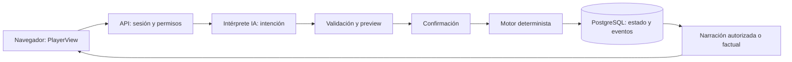
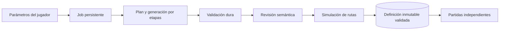

# Arquitectura de implementación

Estado: diseño, sin servicios implementados. Derivada del TAD y del plan aceptado; detalles normativos en specs y decisiones en ADR.

## Flujo de una acción

El intérprete no ejecuta acciones. El motor no invoca al proveedor. Confirmar una acción aplica reglas y persiste antes de narrar. Si la IA falla después, se devuelve resultado factual, no se vuelve a ejecutar.

## Flujo de una investigación

Solo la definición validada y guardada crea una partida. El fixture pasa la validación determinista antes de existir el generador. Borradores quedan privados. La revisión IA nunca anula un fallo duro.

## Módulos y responsabilidades

| Módulo previsto | Responsabilidad | No debe hacer |
|---|---|---|
| web | Presentar estado y enviar intenciones/confirmaciones | Resolver culpabilidad ni contener secretos |
| api | Identidad, permisos, coordinación, transacciones y proyección | Mezclar reglas en controladores |
| engine | Reglas, tiempo, efectos y evaluación puros | Red, DB, modelos, hora real |
| case-schema | Contratos y estructura del expediente | Ejecutar expresiones importadas |
| ai-adapters | Transporte/capacidades por proveedor | Mutar partidas |
| case-generator | Pipeline y validación de casos | Crear pruebas después de iniciar |
| worker | Ejecutar jobs persistentes desde fase 4 | Acoplarse a controladores HTTP |
| contratos públicos | DTO de PlayerView/acciones/resultados | Exportar CaseDefinition secreta |
| ui | Componentes realmente compartidos | Convertirse en librería genérica prematura |

Los paquetes se crean al ser utilizados. shared del TAD no obliga a un paquete universal: preferir contratos públicos con ámbito claro.

## Persistencia conceptual

Identidad: User, Session y configuración de instalación. Juego: DetectiveProfile, CaseDefinition, CaseRun, ActionLog y CareerRecord. IA: AIConfiguration, ProviderUsage y jobs. El modelo SQL definitivo se cierra por fase; no todas las tablas nacen en la base inicial.

Un CaseRun referencia contenido inmutable y versión de motor. Evento/estado en la misma transacción. Dossier y conversación forman parte del guardado, pero no se copian a logs técnicos. Las solicitudes internas se ordenan por minutos de juego; los leases del worker por reloj real operativo.

Índices/constraints requeridos antes de implementación: unicidad de claves de acción por partida, versión controlada de partida, recompensa única por perfil/expediente, referencias íntegras y reclamo de job atómico. No confiar en validación de UI para integridad.

## Entornos y red

Desarrollo: UI/API y PostgreSQL local; proveedor en host. Autoalojado: servicios en Compose y proxy según acceso. Público: TLS, registro, proveedor del administrador, límites y operación.

DB no expuesta a Internet. Endpoints de usuarios deshabilitados en público por defecto. La excepción para Ollama privado no se copia a configuración pública. No hay servidor central requerido ni telemetría obligatoria.

## Calidad y evolución

No microservicios, Kubernetes, Redis ni contenedor de DI por adelantado. Medir antes de separar procesos nuevos. API y worker pueden escalar independientemente sin dividir el dominio en servicios de red.

Cambios a condiciones/efectos o clock semantics requieren compatibilidad de motor y ADR. Cambios de modelos no cambian verdad. Evolución del esquema rechaza versiones futuras y migra explícitamente; no reescribe contenido de partidas activas.
